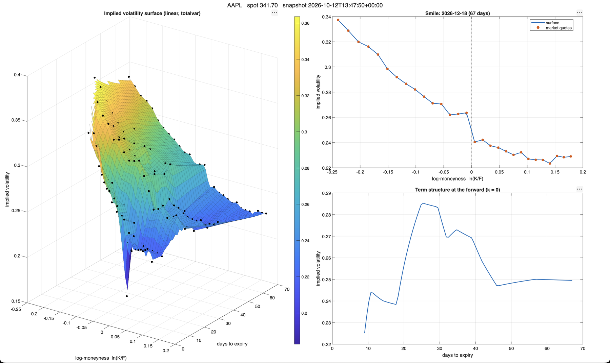

# Black-Scholes Options Pricing Engine

A from-scratch implementation of the Black-Scholes-Merton (BSM) pricing model built to understand quantitative finance through the lens of applied mathematics — specifically how multivariable calculus and PDEs map directly to real financial instruments. Connects to live market data to back-solve implied volatility and surface potential mispricings against historical volatility.

It also includes a **MATLAB implied volatility surface** tool: one call takes a ticker to an interactive-ready figure with the 3D surface, a smile, and a term structure, with every implied volatility cross-checked against the OCaml engine. See [Volatility Surface (MATLAB)](#volatility-surface-matlab).



_AAPL snapshot from 12 Oct 2026 (spot 341.70): interpolated surface with the 140 market quotes overlaid (left), the smile for the 2026-12-18 expiry (top right), and the at-the-forward term structure (bottom right)._

---

## The Math Story

### Origins

In 1900, Louis Bachelier published his doctoral thesis _Théorie de la Spéculation_ —
the first mathematical treatment of random walk applied to financial markets. He
modeled price movements as a stochastic process five years before Einstein's paper
on Brownian motion. The work was largely ignored for six decades until Paul Samuelson
rediscovered it in the 1950s and formalized it as geometric Brownian motion — the
foundation BSM is built on.

Black, Scholes, and Merton published the pricing model in 1973. Merton and Scholes
were awarded the Nobel Prize in Economics in 1997.

### What Problem BSM Solves

An options contract gives you the _right_ (not obligation) to buy or sell a stock at a fixed **strike price** on a future date. The market charges a **premium** for this contract today. BSM answers: **what is the fair premium?**

Given that Apple trades at $200 and you want the right to buy at $210 in 3 months, BSM tells you that contract should cost ~$8.50 today. If Apple hits $230 at expiration you net $20 minus the $8.50 premium = $11.50 profit. If it stays below $210 you lose the $8.50 and walk away.

### The Derivation Chain

```
Assumptions
    → Geometric Brownian Motion (stock price SDE)
        → Ito's Lemma (stochastic chain rule)
            → BSM PDE (eliminate randomness via hedging)
                → Closed Form Solution
                    → Greeks (partial derivatives of the solution)
```

**Key assumptions BSM makes (and where it breaks down):**

- Volatility is constant — it isn't
- Log-normal returns — fat tails exist
- Continuous trading, no transaction costs — not realistic
- No dividends — requires adjustment for dividend-paying stocks

### The Closed Form Solution

```
d1 = [ln(S/K) + (r + σ²/2)T] / σ√T
d2 = d1 - σ√T

Call = S·N(d1) - K·e^(-rT)·N(d2)
Put  = K·e^(-rT)·N(-d2) - S·N(-d1)
```

Where `N()` is the cumulative standard normal distribution.

**d2 is derived from d1** — not computed independently — because the only difference between their expanded forms is `+σ²/2` vs `-σ²/2` in the numerator, which simplifies to exactly `σ√T`.

---

## Inputs

| Variable         | Symbol | Meaning                                                          |
| ---------------- | ------ | ---------------------------------------------------------------- |
| Stock price      | `S`    | Current market price of the underlying                           |
| Strike price     | `K`    | Price at which you can buy/sell, fixed in the contract           |
| Time to maturity | `T`    | Time remaining until expiration, in years (e.g. 3 months = 0.25) |
| Risk-free rate   | `r`    | Treasury yield — return you'd get risk-free                      |
| Volatility       | `σ`    | Implied volatility — market's estimate of future price movement  |

In live mode, `S`, `r`, and `T` are fetched automatically. `r` is pulled from the appropriate Treasury yield based on time to expiration — 3-month T-bill for short-dated contracts, 5-year for medium, 10-year for long.

---

## Output

### Prices

- **Call price** — fair premium for the right to _buy_ at strike K
- **Put price** — fair premium for the right to _sell_ at strike K

All prices are quoted per share. Market convention is 100 shares per contract.

### The Greeks (Risk Dimensions)

| Greek | Derivative | Meaning                                         |
| ----- | ---------- | ----------------------------------------------- |
| Delta | ∂C/∂S      | How much the price changes per $1 move in stock |
| Gamma | ∂²C/∂S²    | How fast delta itself is changing               |
| Theta | ∂C/∂t      | Value lost per day from time passing            |
| Vega  | ∂C/∂σ      | Sensitivity to a change in volatility           |
| Rho   | ∂C/∂r      | Sensitivity to a change in interest rate        |

Traders use Greeks for **risk management**, not just pricing. A market maker selling thousands of contracts needs to know total exposure if the market moves 2% tomorrow — that's delta. Greeks quantify each risk dimension independently.

---

## Project Structure

```
black-scholes/
├── bsm.py              # All math functions — knows nothing about dataframes or market data
├── chain.py            # Options chain construction — knows nothing about math internals
├── market.py           # Live market data fetching, IV back-solving, HV computation
├── ocaml_bridge.py     # Subprocess bridge to the OCaml engine
├── rich_out.py         # Terminal table rendering via rich
├── bsm_tui.py          # Textual terminal UI for live chains
├── main.py             # Entry point — manual mode and live mode
├── surface_export.py   # Snapshots a full options chain to CSV for the MATLAB surface
├── bsm_engine/         # OCaml compute backend (dune project)
├── matlab/             # Volatility surface pipeline — entry point is vol_surface.m
├── snapshots/          # Generated CSV/JSON chain snapshots (git-ignored)
├── docs/               # Project proposal (LaTeX + PDF), design notes, figures
└── tests/
    └── test_bsm.py     # pytest validation against known values and finite difference verification
```

Each file has one job. `bsm.py` computes math. `chain.py` organizes manual results. `market.py` handles everything external. `main.py` orchestrates both modes.

---

## Modes

```bash
python main.py manual   # run BSM across a synthetic price range with fixed inputs
python main.py live     # pull live market data and analyze real options chains
python surface_export.py AAPL --max-expiries 8   # snapshot a full chain to snapshots/AAPL_<timestamp>.csv
```

---

## OCaml Compute Backend

All pricing, Greeks, and IV solving are handled by the native OCaml binary. Python handles market data fetching, wrangling, and display while OCaml handles the math.

### Why OCaml

BSM math is computationally pure meaning there is no I/O or side effects, only floating point arithmetic over the options chain. OCaml compiles to native code and reuns the calculations much faster than CPython by reducing the operations that need to be done by the computer and avoiding the issues that come with arithmetic in garbage collected languages like Python.

The integration uses a subprocess bridge, Python spwans OCaml binary once per row, passes inputs, and reads back a JSON object

## Volatility Surface (MATLAB)

Black-Scholes assumes one constant volatility. Inverting real market prices says otherwise: every strike and expiry implies a different `σ`. The MATLAB pipeline in [`matlab/`](matlab) pulls a whole options chain, solves the implied volatility of each quote, cross-checks it against the OCaml engine, and draws the resulting surface. It was built for a numerical and symbolic computation course; the proposal is in [`docs/vol_surface_proposal.pdf`](docs/vol_surface_proposal.pdf).

### Quick start

```matlab
cd matlab
vol_surface("AAPL")                                   % live snapshot -> figure
vol_surface("AAPL", "Refresh", false)                 % reuse snapshots/AAPL_latest.csv (no network)
vol_surface("AAPL", "Session", "prior")                 % before the open: rebuild yesterday from last trades
vol_surface("AAPL", "Session", "auto")                  % live if possible, otherwise yesterday
out = vol_surface("MSFT", "MaxExpiries", 6, "Expiry", "2026-11-20");   % optional options + returned data
```

**Requirements**

- MATLAB R2020a or newer with the Symbolic Math Toolbox (and the Statistics and Machine Learning Toolbox, for one percentile in the summary printout)
- A Python environment with `yfinance`, `pandas`, `numpy` and `scipy`. `vol_surface` finds one automatically (this repo's `.venv`, then MATLAB's `pyenv`, then `python3`); pass `"Python", "/path/to/python"` to choose one
- The OCaml binary built (`dune build` in `bsm_engine/`) for the cross-check, or pass `"UseOCaml", false` to skip it

**Market hours matter.** Outside regular hours (9:30-16:00 ET), and in the first minutes after the open, most bids and asks are zero. `surface_export.py` refuses to write a snapshot with fewer than 20 usable quotes or fewer than 2 expiries (`--min-rows` changes the first limit), and `vol_surface` falls back to the cached `*_latest.csv` with a warning. `snapshots/` is git-ignored, so the very first run needs a live fetch.

**Before the open: `"Session", "prior"`.** Yahoo only serves the *current* chain, so yesterday's chain can't be downloaded. Instead, prior mode rebuilds it from each contract's last trade, keeping only trades from the final hour of the previous session (`"PriorWindowMin"`, default 60) and pricing them against that session's closing price. It also works shortly after the open: the share of contracts that have already traded today (whose last price is no longer yesterday's) is measured, and the snapshot is refused if it exceeds 20% (`--max-overwritten`), because liquid at-the-money contracts trade first and the sample would skew toward illiquid strikes. The result is noisier than a live snapshot because the last trades are not simultaneous. Prior-session snapshots are saved as `<TICKER>_<date>_prior.csv` and `<TICKER>_prior_latest.csv`, so they never overwrite a live `*_latest.csv`; the figure title is tagged accordingly. `"Session", "auto"` tries live first and falls back to the prior session.

### How it works

| Stage | File | What it does |
| ----- | ---- | ------------ |
| Snapshot | `surface_export.py` | One spot price per snapshot, risk-free rate per tenor. Drops zero or crossed quotes, spreads wider than 50% of mid, zero open interest, mids at or below intrinsic value, and expiries under 7 days. Adds the OCaml reference IV. Writes a tidy CSV and a metadata JSON |
| Load | `load_chain.m` | Validates any CSV with the snapshot columns; clear errors for missing columns or bad types |
| Symbolic | `bs_symbolic.m` | Derives price, vega, delta and gamma with the Symbolic Math Toolbox (with dividend yield `q`; `q = 0` is the OCaml model), compiles them with `matlabFunction`, and checks the Black-Scholes PDE and put-call parity |
| Solve | `implied_vol.m` | Newton-Raphson using the symbolic vega, kept inside a shrinking bracket; falls back to bisection when vega is tiny or a step leaves the bracket. Returns `NaN` for prices outside no-arbitrage bounds |
| Forward | `forward_from_parity.m`, `select_otm.m` | `F = K + e^(rT)(C - P)`, median over the five strikes nearest spot, per expiry. Only out-of-the-money quotes are used (puts below `F`, calls at or above it) |
| Surface | `build_surface.m` | Linear interpolation of total variance `w = σ²T` over a Delaunay triangulation of (log-moneyness, maturity), both rescaled to [0, 1]. No extrapolation: outside the data, the surface is `NaN` |
| Views | `smile_slice.m`, `term_structure_slice.m`, `plot_surface.m`, `vol_surface.m` | Smile for one expiry, term structure at fixed moneyness, 3D plot, and the one-call entry point |

### Snapshot format

One row per contract, so the MATLAB side works on any CSV that follows it:

```
symbol, asof, spot, expiry, T, r, q, type, strike, bid, ask, mid,
spread_pct, volume, open_interest, iv_ocaml, iv_yahoo
```

`T` is in years (days / 365.25, matching the engine). `q` is written as `0.0` because the engine has no dividend term. `iv_ocaml` is optional; without it the cross-validation is skipped.

### Validation

| Check | Result |
| ----- | ------ |
| Symbolic PDE and put-call parity | proved symbolically; numeric residual 2e-14 |
| IV round trip on a grid (142 well-posed cases) | worst error 3.1e-7 |
| AAPL snapshot, 12 Oct 2026: 140 OTM contracts, 8 expiries | all converged, no bisection fallback needed |
| Difference from the OCaml engine on that snapshot | median 2.6e-7, max 5.0e-7 |
| Interpolation error on an analytic surface | under 5e-4 (volatility space), 3.5e-3 (total variance) |

The 5.0e-7 maximum is the rounding error of the OCaml engine, which prints its IV to six decimals, so the two solvers agree to the precision the engine reports.

Run the offline tests (no market data needed) from `matlab/`:

```matlab
test_vol_pipeline    % symbolic checks, IV round trip, arbitrage-violating prices, end-to-end on a synthetic CSV
test_surface         % interpolation accuracy, no extrapolation, slices, duplicate points, input validation
```

### Reading the figure

- **Left:** the interpolated surface. Black dots are the market quotes it was built from; gaps are regions outside the data, left blank on purpose rather than extrapolated.
- **Top right:** the smile for one expiry (by default the one with the most quotes). Implied volatility is highest for low strikes and falls as the strike rises, the usual skew for equity options, which constant-volatility Black-Scholes cannot produce.
- **Bottom right:** implied volatility at the forward (`k = 0`) across maturities.
- **Known artifact:** the sharp dip at the short end of this particular snapshot comes from one thinly quoted expiry (9 days, only 4 out-of-the-money quotes with spreads of 25-37%). It reflects poor quotes, not a market signal.

A second window, **How to read the surface**, opens alongside it (`explain_surface.m`; disable with `"Explain", false`). It explains, with no options background assumed, what an option is, what volatility and implied volatility mean, and what the smile and term structure show, using the ticker's own data in every panel.

### Documentation and verification

- `docs/vol_surface_user_guide.pdf`: how to install, run and troubleshoot `vol_surface`.
- `docs/scientific_computing_principles.pdf`: the numerical and symbolic ideas behind the project, in plain language.
- `docs/verification_process.pdf`: a sample procedure showing the tool works. Run `verify_demo` in MATLAB (add a snapshot path to include real data) and `python3 matlab/verify_independent.py <snapshot.csv>` for an independent check.
- `matlab/verify_covid_crash.m`: a visual verification on a stylized reconstruction of the March 2020 volatility panic (calm Feb 2020 vs the VIX record close of 82.69 on 16 Mar 2020). It plants a known surface, runs it through the same pipeline as live tickers, and shows the tool recovers it. Free historical chains are not available, so the surface is illustrative, not market data.

### Limitations and next steps

- Listed equity options are American-style; the model ignores early-exercise value. That matters most for in-the-money options, which is one reason only out-of-the-money quotes are used.
- No dividend term in the engine (`q = 0`), so the forward is inferred from put-call parity.
- Yahoo Finance data is delayed and noisy, and the interpolated surface is not guaranteed to be free of arbitrage.
- Next: a minimum-quotes-per-expiry filter, an App Designer interface, and a parametric (SVI) fit per expiry with butterfly and calendar no-arbitrage checks.

---

## Implementation Decisions

**Why `option_type` is a parameter, not two separate functions**

Delta for calls is `N(d1)`. For puts it's `N(d1) - 1`. They share 90% of their logic. One function with a parameter is cleaner than two parallel functions that diverge by one line — especially when running these across thousands of contracts in a loop.

**Why d2 takes d1 as input**

It's not a shortcut — that's the actual mathematical relationship. Expressing it this way makes the dependency explicit in code and avoids recomputing the expensive log/sqrt terms.

**Why helpers are extracted into small functions**

`black_scholes()` should read like a sentence. Extracting `compute_d1()`, `compute_d2()`, `call_price()`, `put_price()` means the top-level function communicates _what_ is happening without requiring the reader to parse _how_.

**Theta time unit parameter**

Theta from BSM is in per-year units. Traders think in per-day. A `time_unit` parameter handles both without duplicating logic. Named `time_unit` rather than `filter` — `filter` is a Python builtin and shadowing builtins causes subtle bugs.

**Why bid/ask midpoint is preferred over lastPrice**

`lastPrice` reflects the most recent trade, which can be hours old for illiquid contracts. The bid/ask midpoint is a live estimate of fair value. The spread between bid and ask also signals liquidity — a wide spread means the contract trades infrequently and pricing is less reliable.

**Why IV is back-solved rather than taken from the data provider**

Using our own Newton-Raphson implementation against the actual BSM model guarantees consistency — the IV we compute is exactly the sigma that makes our model reprice the contract correctly. Provider-supplied IV may use different models or conventions.

**Why OCaml uses typed float operators**

OCaml has no implicit numeric casting. + is integer addition, +. is float addition — mixing them is a compile error. For financial math this is a feature: a misplaced integer operation that silently truncates a float is caught at build time, not at runtime with wrong numbers.

---

## Finite Difference Verification

The Greeks are derived analytically (closed form). They are verified numerically using finite differences — the computational approximation of a derivative:

```
f'(x) ≈ [f(x+h) - f(x-h)] / 2h
```

For example, numerical delta:

```python
numerical_delta = (call_price(S+h) - call_price(S-h)) / (2*h)
```

This matches `N(d1)` within floating point tolerance, confirming the implementation is correct. Each Greek was verified this way before moving to the next. These checks are encoded in the test suite and run with `pytest tests/ -v`.

---

## Implied Volatility

`σ` is back-solved from live market prices using Newton-Raphson, with vega as the derivative:

```
σ_new = σ_old - (BSM_price(σ_old) - market_price) / vega(σ_old)
```

This inverts the model: instead of computing a price from volatility, it extracts the volatility the market is pricing in. The solver guards against division by zero near expiry and deep out-of-the-money contracts where vega approaches zero.

---

## IV vs Historical Volatility

Implied volatility reflects what the market _expects_ future movement to be. Historical volatility reflects what the stock _actually_ moved over the past 90 days, annualized:

```python
returns = np.log(hist["Close"] / hist["Close"].shift(1)).dropna()
hv = returns.std() * np.sqrt(252)
```

The spread between IV and HV is the primary signal. When IV significantly exceeds HV, the market is pricing in more uncertainty than history suggests — the option is expensive relative to realized volatility. When IV is below HV, options are cheap.

---

## Resources

- **Paul Wilmott on Quantitative Finance** — rigorous BSM derivation from PDEs
- **Python for Finance** by Yves Hilpisch — practical numpy/scipy implementation patterns
- **MIT 18.S096** (OpenCourseWare) — bridges Calc 3 level math to derivatives pricing
